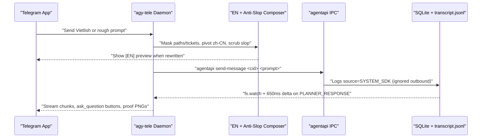

# agy-tele

Fast bidirectional sync between Telegram and 24/7 macOS Antigravity Desktop machines using local `agentapi` IPC, read-only `bun:sqlite` FTS5 queries, and byte offset tails of `transcript.jsonl`.

Official Antigravity Remote Control mirrors desktop UI state through a web relay, which feels sluggish over mobile connections. `agy-tele` keeps everything local on your Mac: Telegram sends tiny text updates, a local Bun daemon transforms casual Vietnamese, Vietlish, or rough drafts into plain zero-dash English (`Flow-Gen-EN` and `No-AI-Slop`), `agentapi` injects the prompt into a live Desktop conversation, and incremental transcript tailing streams replies back to your phone in under a second.

## Architecture

The diagram below traces both inbound Telegram messages (`agentapi send-message`) and outbound Desktop events (`USER_EXPLICIT` and `PLANNER_RESPONSE`) while blocking `SYSTEM_SDK` echo loops.



## Quick Setup

1. Create a Telegram bot with `@BotFather` and grab your numeric user ID from `@userinfobot`.
2. Copy the sample environment file and add your bot token and allowed user IDs:

```bash
cp .env.example .env
```

3. Install development dependencies and run local host diagnostics before starting the daemon:

```bash
bun install
bun run doctor
```

4. Start the foreground daemon, or register the macOS `launchd` background service for 24/7 uptime:

```bash
bun run start
# Optional background LaunchAgent:
bun run install:launchd -- --load
```

## Telegram Commands

| Command | Action | Notes |
| :--- | :--- | :--- |
| `/threads [query]` | Lists recent Desktop conversations | Uses read-only `conversations_fts` FTS5 search with inline bind buttons |
| `/bind <id>` | Binds chat or Forum Topic to a thread | Accepts full UUID or unique prefix and seeks cursor to current EOF |
| `/new [dir ::] <prompt>` | Starts a new Desktop conversation | Defaults to `AGY_DEFAULT_WORKSPACE` unless `dir ::` is supplied |
| `/en <draft>` | Previews Flow-Gen-EN output | Translates and scrubs drafts without sending to Desktop |
| `/raw <text>` | Sends text verbatim | Bypasses translation and anti-slop rewriting for one message |
| `/mode [auto\|always\|off]` | Reads or sets per-thread compose mode | Persists choice inside `.state/agy-tele-state.json` |
| `/tail [count]` | Shows recent finalized Desktop turns | Prints up to 12 recent user and assistant events on demand |
| `/shot <path>` | Sends a local screenshot file | Supports `.png`, `.jpg`, `.jpeg`, and `.webp` paths on the Mac |
| `/status` | Reports active binding and cursor state | Pings `agentapi get-conversation-metadata` live |

## Flow-Gen-EN and No-AI-Slop Composer

Before calling Google Translate `gtx` (`auto -> zh-CN -> en`) or running local anti-slop rules, `src/composer.ts` masks fenced code blocks, inline code spans, Markdown links, URLs, file paths, ticket keys (`ENG-2716`), `@mentions` (`@ducnmm`), and multi-hyphen project slugs (`ai-video-maker`) behind `ZXQTOK000X` placeholders. After translation and zero-dash scrubbing, it restores every token verbatim and checks numeric, ticket, and mention parity via `checkSemanticDrift`. If the network is offline or a placeholder drifts, it reverts automatically to deterministic local normalization so machine identifiers stay intact.

Test the composer directly from your terminal:

```bash
bun run compose "check PR ENG-2716 in ai-video-maker, leverage cache to streamline it for @ducnmm"
```

## Verification

| Verified Scenario and Invariants | Command | Observed Result |
| :--- | :--- | :--- |
| **Composer masking, zero-dash scrubbing, and offline fallback**: Verifies `ENG-2716`, `@ducnmm`, fenced code, and `ai-video-maker` survive both scrubbing and Vietlish fallback without dashes or AI-slop verbs. | `bun test tests/composer.test.ts` | 5 passed, 0 failed |
| **SQLite FTS5 index and transcript delta cursoring**: Tests read-only `conversation_summaries.db` filtering (`nesting_depth = 0`), partial trailing line buffering, `SYSTEM_SDK` echo suppression, `transcript_full.jsonl` truncation recovery, and message chunking. | `bun test tests/antigravity.test.ts` | 3 passed, 0 failed |
| **End-to-end daemon round-trip**: Confirms unauthorized user rejection, inline `bind:<id>` callback handling, prompt composition, `PLANNER_RESPONSE` streaming, and `ask_question` option callbacks across 9 total tests and 80 assertions. | `bun test && bun run typecheck` | 9 passed, 0 failed; TypeScript clean |
| **Live macOS host IPC and SQLite read check**: Executed against the active Antigravity Desktop database and `agentapi` binary on macOS. | `bun run doctor && bun run threads -- --limit 5` | `conversation_summaries.db` read in `2.7ms`; 5 threads listed in `2.8ms`; FTS5 search in `14.1ms`; `agentapi` metadata lookup in `226.9ms` |

## Limitations

1. Live Telegram Bot API long-polling (`getUpdates`) and `sendPhoto` uploads require a valid bot token from `@BotFather` in `.env`, which was not provisioned in this offline verification run; daemon behavior was verified against a typed mock `TelegramClient`.
2. Outbound sync streams finalized `DONE` steps from `transcript.jsonl` rather than streaming partial mid-token deltas.
